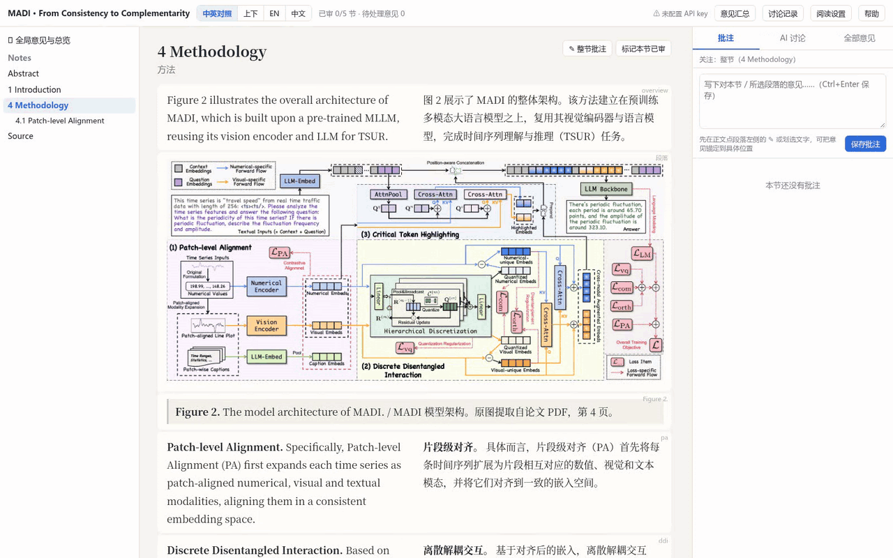

# PaperBridge

**中英对照读论文，直接在段落旁批注。**

本地运行，保留原始图表，支持 AI 讨论。Python 3.10+，无需安装依赖；阅读和批注无需 API key。



演示使用 [MADI · EMNLP 2026](https://aclanthology.org/2026.emnlp-main.713/)：双语阅读 → 段落批注 → 原图查看 → 字号与主题切换。[素材说明](examples/demo/SOURCE.md)

## 开始使用

```bash
git clone https://github.com/gry1024/paperbridge.git
cd paperbridge
python3 paperbridge.py serve examples/demo
```

打开 [localhost:8765](http://localhost:8765)。

## 换成你的论文

```bash
python3 paperbridge.py init /path/to/paper.md --workspace /path/to/review
python3 paperbridge.py serve /path/to/review
```

使用带段落编号的双语 Markdown，图表直接引用原始图片或 PDF。每篇论文的批注与讨论独立保存，可导出为修改清单。支持左右/上下对照、字号、字体与五种阅读主题。

可选 AI 讨论：在工作区配置 [`.env.example`](.env.example) 中的三个字段，重启即可。当前不直接导入整篇 PDF、Word 或 LaTeX。

[使用指南](docs/guide.md) · [反馈问题](https://github.com/gry1024/paperbridge/issues) · [MIT](LICENSE)
