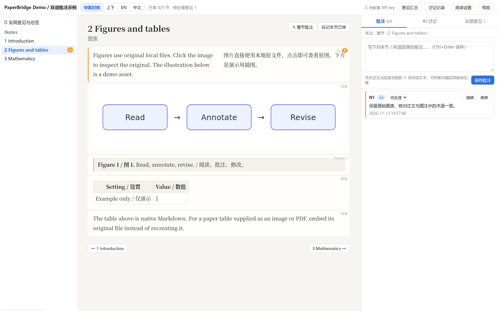

# PaperBridge · 论文双语批注台

Read in two languages. Annotate once. Revise with context.

一个本地运行的中英双语论文阅读与批注工作台：逐节对照、段落批注、原图展示、可选 AI 讨论，以及供修改助手读取的意见清单。Python 3.10+，服务端仅使用标准库；阅读与批注无需 API key。



## 快速开始

```bash
git clone https://github.com/gry1024/paperbridge.git
cd paperbridge
python3 paperbridge.py serve examples/demo
```

打开 <http://127.0.0.1:8765>。Windows 用户也可以在 WSL 中运行后用 Windows 浏览器打开此地址；原生 Windows 可使用 `python` 替代 `python3`。

## 接入自己的论文

```bash
python3 paperbridge.py init /path/to/paper/paper_bilingual.md --workspace /path/to/paper/review
python3 paperbridge.py serve /path/to/paper/review --port 8765
```

初始化只创建配置，不复制、覆盖或修改稿件。每篇论文有独立工作区：

```text
my-paper/
├── paper_bilingual.md
├── figures/                 # 原始图片或 PDF 图表
└── review/
    ├── config.json
    ├── data/review.json      # 批注、对话、审阅进度的数据源
    ├── REVIEW_NOTES.md       # 自动导出的意见清单
    └── CHAT_LOG.md           # 自动导出的讨论记录
```

不要手改导出文件；备份整个工作区即可保留批注。Git 默认忽略数据、讨论和密钥。项目仅包含虚构演示，不包含作者的研究稿件。

## 双语稿格式

使用 Markdown 标题划分章节，用稳定的段落 ID 对齐英文和中文。同节内同 ID 可不相邻，也支持中文在前。

```markdown
# Paper title / 论文标题

## 1 Introduction / 引言

**[intro-motivation] Motivation. / 动机。** English paragraph.

**[intro-motivation]** 中文段落。


```

建议用 `intro-motivation` 这样的稳定 ID，避免章节重排造成配对错乱。旧稿出现英文 `[5.1c]`、中文 `[4.1c]` 时，可在 `config.json` 显式指定：

```json
{
  "paper": "../paper_bilingual.md",
  "paragraph_aliases": {"4.1c": "5.1c"},
  "context_files": {}
}
```

映射只改变阅读视图，不修改稿件，旧编号上的批注仍可定位。映射必须一跳指向最终 ID。未匹配段落会显示提示，不凭相邻关系猜测翻译。无编号 Markdown 仍可阅读和批注，但按共享内容展示。当前默认语言识别针对英文/中文，尚不自动翻译，也不直接解析 LaTeX、Word 或整篇 PDF；可先导出保留稳定 ID 的双语 Markdown 阅读稿。

## 原始图表

- 图片：``；支持 PNG、JPEG、SVG、WebP、GIF。
- PDF 图表：``，直接嵌入原 PDF，并提供原文件链接；是否能内嵌取决于浏览器 PDF 阅读器。
- 兼容旧稿图注中的反引号路径，例如 `` `figures/original.pdf` ``。
- 图、表若有原始图像或 PDF，直接引用该文件；不重绘、不生成替代图、不把原图重新压缩。主题不会给图片加滤镜。
- 原生 Markdown 表格保持表格形式。只有表格文本时，本工具不会伪造一张“原图”。

资源放在稿件目录内或其子目录。只开放稿件显式引用的图片/PDF；外链图片提示先保存到本地。图片使用内联 Markdown 路径（带空格可用 `<figures/my plot.png>`），不支持引用式图片或 LaTeX `includegraphics` 自动提取。

## 阅读与修改

- 阅读设置：12–30px 字号，衬线/无衬线/等宽字体，纸白/明亮/暖黄/护眼绿/深夜主题，以及自定义页面背景色。设置在当前浏览器保存；实际字体由系统可用字体决定。
- 中英左右对照、上下对照、仅英文、仅中文；左右箭头切节，`L` 切换语言布局。
- 点段落旁 ✎ 或选中文字后批注；`Ctrl+Enter` 保存。可标记待处理、已处理、不改。
- 对 AI 助手说“读取这个工作区的 REVIEW_NOTES.md，按意见修改原稿并回填处理说明”。

CLI 在工作区运行，修改通过运行中的服务写入，避免覆盖网页正在保存的意见：

```bash
cd /path/to/paper/review
python3 /path/to/paperbridge/review_cli.py list
python3 /path/to/paperbridge/review_cli.py resolve N1 "已重写对应段落"
```

自定义服务端口时设置 `PAPERBRIDGE_URL=http://127.0.0.1:8766`。也可用 `PAPERBRIDGE_WORKSPACE` 指定工作区。网页会轮询加载稿件与批注变化；配置变更需要重启服务。

## 可选 AI 讨论

把 `.env.example` 中的字段填入工作区的 `.env`，或设为环境变量，再重启。支持 OpenAI-compatible Chat Completions 接口。`REVIEW_OPENAI_*` 环境变量优先，其次 `OPENAI_*` 环境变量，再其次工作区或最近上级目录的 `.env`。选择你供应商支持的模型名。

每节有独立对话；可附加全文与 `context_files` 中选定的参考材料。只有点击发送/总结时才请求所配置的模型服务。发送内容包括所选稿件文字、批注和对话；当前 AI 为文本输入，不分析原图像素。离线阅读和人工批注不请求外部服务。

这是单用户本地工具，只绑定 localhost，没有远程账户和多人协作认证。请勿通过公网反向代理直接暴露。

## 开发与验证

```bash
python3 -m unittest discover -s tests -v
node --check static/app.js
```

核心：`server.py`（解析、数据、HTTP、AI），`static/`（界面），`paperbridge.py`（工作区入口），`review_cli.py`（意见操作）。欢迎提交可复现的问题、示例稿件片段和 PR；请先去除私人论文内容、密钥和对话。

MIT license. Bundled libraries and fonts retain their own notices; see [THIRD_PARTY_NOTICES.md](THIRD_PARTY_NOTICES.md).

## English overview

PaperBridge is a local-first English/Chinese paper annotation workbench. It pairs paragraphs by stable IDs, displays original image/PDF assets, saves comments and review progress per paper, exports actionable Markdown notes, and optionally connects to an OpenAI-compatible model for section-level discussion. Five reading themes, font families, text size, and custom page backgrounds are available. Start with `python3 paperbridge.py serve examples/demo`; initialize your own workspace with `init`. The current input format is Markdown, not raw LaTeX, Word, or full-paper PDF. All reading and manual annotation work without an API key.
