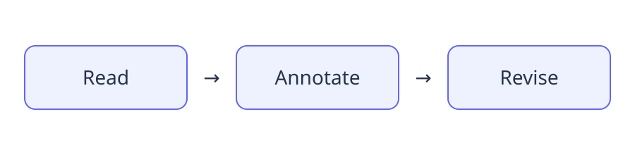

# PaperBridge Demo / 双语批注示例

## 1 Introduction / 引言

**[1a] Purpose. / 目的。** Read both versions together and leave comments on the same paragraph. This is a fictional demonstration, not research evidence.

**[1a]** 对照阅读两种语言，并在同一段落上留下批注。这是虚构的功能演示，不是研究证据。

**[1b]** Keep stable paragraph IDs even when section numbering changes.

**[1b]** 章节重排时，保留稳定的段落编号。

## 2 Figures and tables / 图表

**[2a]** Figures use original local files. Click the image to inspect the original. The illustration below is a demo asset.

**[2a]** 图片直接使用本地原文件，点击即可查看原图。下方是演示用插图。

> **Figure 1 / 图 1.** Read, annotate, revise. / 阅读、批注、修改。

| Setting / 设置 | Value / 数值 |
| --- | --- |
| Example only / 仅演示 | 1 |

The table above is native Markdown. For a paper table supplied as an image or PDF, embed its original file instead of recreating it.

## 3 Mathematics / 公式

**[3a]** Inline notation $x_i$ and display equations remain readable.

**[3a]** 行内符号 $x_i$ 与独立公式均可阅读。

$$
y = \sum_{i=1}^{n} x_i
$$
