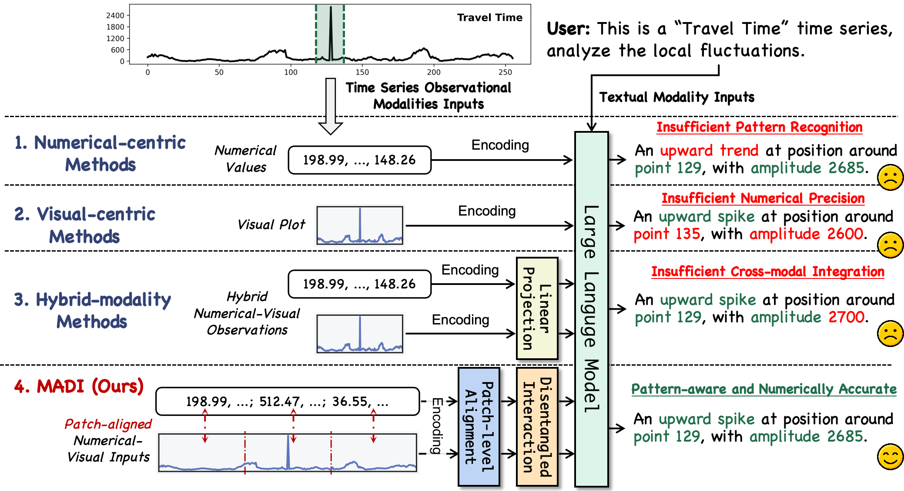
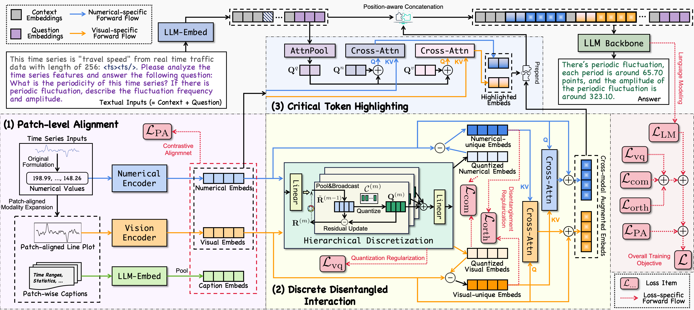

# MADI · From Consistency to Complementarity

## Abstract / 摘要

**[abstract]** Advances in multi-modal large language models (MLLMs) have inspired time series understanding and reasoning tasks. Recent attempts hybridize numerical time series with their visualized plots, facilitating precise value reasoning and visual structure comprehension for comprehensive time series understanding of MLLMs. However, effective numerical-visual modality integration remains challenging due to fine-grained temporal misalignment across modalities and severe entanglement between shared and modality-specific semantics, which hinder localized interpretation and complementary reasoning.

**[abstract]** 多模态大语言模型（MLLM）的进展推动了时间序列理解与推理任务的发展。近期研究将数值时间序列与其可视化图形相结合，以兼顾精确的数值推理与视觉结构理解，帮助 MLLM 全面理解时间序列。然而，数值与视觉模态的有效融合仍面临挑战：模态之间存在细粒度的时间错位，共享语义与模态特有语义也严重纠缠，妨碍了局部解释与互补推理。

**[contributions]** To address these issues, we propose MADI, a multi-modal LLM enhanced with fine-grained alignment and disentangled interaction, featuring (1) Patch-level Alignment, which enforces physically grounded fine-grained correspondence across heterogeneous modalities, (2) Discrete Disentangled Interaction, which separates modality-common semantics into compact discrete latents and adaptively synergizes the purified modality-unique information, and (3) Critical-token Highlighting, which emphasizes informative, query-relevant signals for robust reasoning.

**[contributions]** 为解决这些问题，作者提出 MADI，通过细粒度对齐与解耦交互增强多模态大语言模型，包含三个模块：（1）片段级对齐，在异构模态之间建立具有物理依据的细粒度对应关系；（2）离散解耦交互，将模态共有语义分离到紧凑的离散潜在表示中，并自适应协同利用净化后的模态特有信息；（3）关键 token 强调，突出信息丰富且与问题相关的信号，以支持稳健推理。

## 1 Introduction / 引言

**[alignment]** Numerical values and visual plots describe the same physical signal, but they are usually encoded independently, leading to representational misalignment that hinders cross-modal reasoning. This problem is further amplified by the vision-language pre-training gap in MLLMs, making numerical interpretation less reliable than visual understanding.

**[alignment]** 数值与可视化图形描述的是同一物理信号，但通常被独立编码，导致表示错位，妨碍跨模态推理。MLLM 中视觉与语言预训练之间的差距进一步放大了这一问题，使数值解释的可靠性低于视觉理解。

> **Figure 1.** Comparison of multi-modal architectures. / 多模态架构对比。

## 4 Methodology / 方法

**[overview]** Figure 2 illustrates the overall architecture of MADI, which is built upon a pre-trained MLLM, reusing its vision encoder and LLM for TSUR.

**[overview]** 图 2 展示了 MADI 的整体架构。该方法建立在预训练多模态大语言模型之上，复用其视觉编码器与语言模型，完成时间序列理解与推理（TSUR）任务。

> **Figure 2.** The model architecture of MADI. / MADI 模型架构。原图提取自论文 PDF，第 4 页。

**[pa] Patch-level Alignment. / 片段级对齐。** Specifically, Patch-level Alignment (PA) first expands each time series as patch-aligned numerical, visual and textual modalities, aligning them in a consistent embedding space.

**[pa]** 具体而言，片段级对齐（PA）首先将每条时间序列扩展为片段相互对应的数值、视觉和文本模态，并将它们对齐到一致的嵌入空间。

**[ddi] Discrete Disentangled Interaction. / 离散解耦交互。** Based on aligned embeddings, Discrete Disentangled Interaction (DDI) separates modality-shared and unique semantics for numerical and visual inputs and synergizes their complementarities.

**[ddi]** 基于对齐后的嵌入，离散解耦交互（DDI）分离数值与视觉输入中的模态共享语义和特有语义，并协同利用它们的互补性。

**[cth] Critical-token Highlighting. / 关键 token 强调。** Critical-token Highlighting (CTH) then identifies informative, question-relevant tokens from the PA-aligned embeddings and prepends them to the DDI-fused multi-modal sequence. The resulting multi-modal embeddings are concatenated with the textual input embeddings and decoded by the LLM to generate the output.

**[cth]** 随后，关键 token 强调（CTH）从 PA 对齐的嵌入中识别信息丰富且与问题相关的 token，并将其置于 DDI 融合后的多模态序列前端。最终的多模态嵌入与文本输入嵌入拼接，再由语言模型解码生成输出。

### 4.1 Patch-level Alignment / 片段级对齐

**[pa-steps]** To establish precise correspondence between numerical and visual modalities and enable accurate MLLM interpretation of numerical inputs, we propose a Patch-level Alignment (PA) module that enforces fine-grained, physically-grounded alignment among numerical, visual, and textual modalities. PA operates at a patch level and consists of three steps: (1) patch-level modality expansion, which constructs patch-aligned textual and visual counterparts; (2) multi-modal encoding, which embeds each modality independently; and (3) contrastive alignment, which employs patch-wise contrastive learning to reduce cross-modal representation gaps.

**[pa-steps]** 为建立数值与视觉模态之间的精确对应关系，并让 MLLM 准确解释数值输入，作者提出片段级对齐（PA）模块，在数值、视觉和文本模态之间实现细粒度、具有物理依据的对齐。PA 在片段层面工作，包含三个步骤：（1）片段级模态扩展，构建与数值片段对应的文本和视觉表示；（2）多模态编码，对各模态独立编码；（3）对比对齐，通过片段级对比学习缩小跨模态表示差距。

## Source / 来源

Hang Ni, Weijia Zhang, Fei Wang, Zezhi Shao, and Hao Liu. **From Consistency to Complementarity: Aligned and Disentangled Multi-modal Learning for Time Series Understanding and Reasoning.** EMNLP 2026, pp. 16540–16562.

[论文与作者信息](https://aclanthology.org/2026.emnlp-main.713/) · [原始 PDF](https://aclanthology.org/2026.emnlp-main.713.pdf) · [作者代码](https://github.com/usail-hkust/MADI)

本演示为论文节选，不是全文。英文摘自原文（省略跨行断词，按段落添加定位编号）；中文为 PaperBridge 提供的非官方对照译文。图 1、图 2 直接提取自 PDF 内嵌图片，未重绘、未缩放像素。界面中的演示批注不是论文作者或审稿人的意见。

论文与图表 © 2026 Association for Computational Linguistics，按 [CC BY 4.0](https://creativecommons.org/licenses/by/4.0/) 使用；中文对照亦按 CC BY 4.0 提供。作者未参与或背书本工具。
